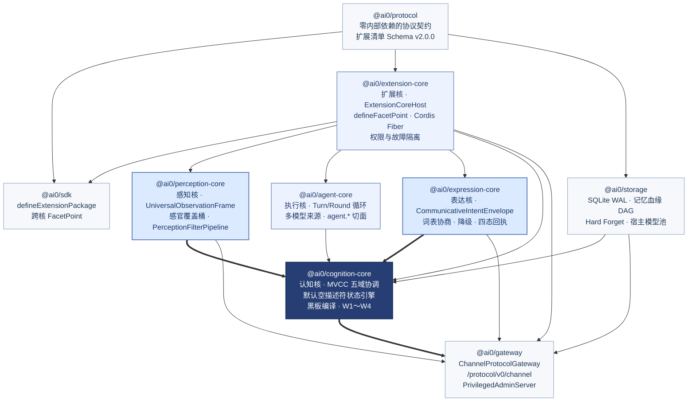

我想做一个可以长期相处的 AI 伴侣。平时聊聊天，一起玩，也一起过些很普通的日子。今天关掉网页，隔几天换个地方见面，她怎么还是她？

## 实现方向：感知、认知、表达

一条消息进来，先过感知，再到认知，最后才决定怎么表达。我想把这三步拆成各自能复用的核心。

- **感知层（上行观察元语言与动态感官自知）`perception-core`**：内核不关心刺激来自哪里，只接收标准化的感知事件。无论是人类的对话、时间的推移、环境的变更还是未来的外部传感器信号，进入内核前都会被抽象成统一的感知输入。

- **大脑认知层（看不见的认知元内核与可插拔认知器官） `cognition-core`**：整个系统的唯一重心。它负责维护记忆、情绪、状态机、内部思考与决策逻辑。它不仅对外界输入做出反应，更能在交互间隙保持状态连续性，决定“要不要回应、怎么想、记住什么”。

- **内在表现层（下行沟通意图元语言、表达传递）`expression-core`**：大脑不直接拼接某个平台的专属消息格式，而是输出结构化的表达意图——包括语义内容、情绪倾向与行为动机。至于这段意图最终被渲染成一段文本、一句带语气的语音，还是一个动作指令，完全交给外部终端自行消费。

## 架构设计

`agent-core` 负责跑话轮、调模型和工具，`extension-core` 负责扩展的授权、启停、重载和故障隔离。认知负责判断，执行这一层也能拿去跑普通的 Agent 任务。

## 仓库

> 缺少、Agent、项目开发经验，设计存在不足。

[`项目地址 · github.com/reina0721/ai0`](https://github.com/reina0721/ai0)
